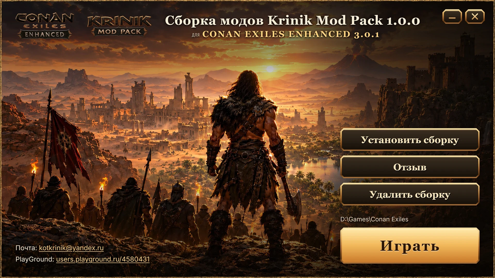
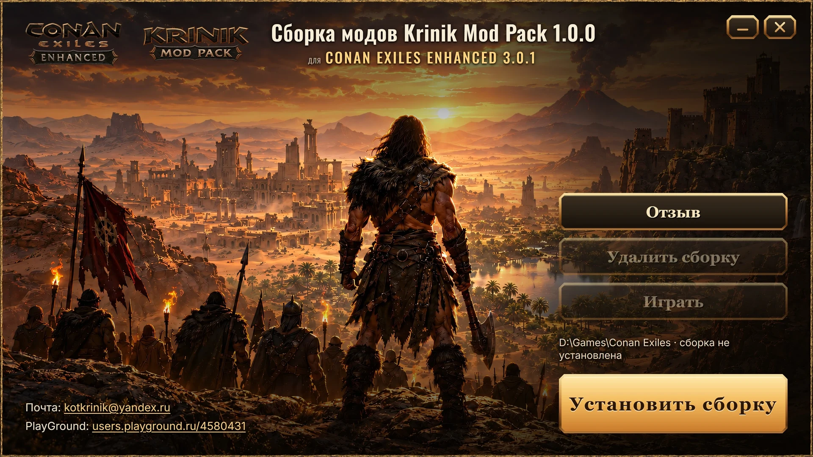

# Интервью #028 — Конан: лаунчер (шрифт названия, главная кнопка), версии сборки, абзац об откате

> Topic: что ждёт вашего слова после чата 31.10 вечером — вид лаунчера, замысел версий и обновлений, вычитка витрины KUMM
> Source of the idea: ваше слово 31.10 19:52 «ждет вас - в интервью с картинками»
> Created: 2026-10-31 19:5x +03:00
> Status: **✅ отвечено 2026-10-31 20:11, внесено 20:18** — В1: название остаётся Oswald, правок нет. В2: главная кнопка теперь зависит от состояния: до установки
> «Играть» нет и золотая «Установить сборку», после — «Установить сборку» скрыта и золотая «Играть». Лаунчер переключается сам, когда закрылся установщик
> (отчёт `testcases/reports/2026-10-31_conan-launcher-main-button-by-state.md`). В3: замысел 23 одобрен; имя публичного репозитория и место архива
> спрошены в чате 20:12. В4: вычитка позже, по вашему слову.

## Что сейчас

Лаунчер собран по утверждённому макету (пак `3c72afd`, кадры — папка «НА ОТСМОТР НИКОЛАЕМ/32_launcher_built»). Два вопроса вида остались открытыми с 18:2x.
Замысел 23 (версии на GitHub и проверка обновлений) записан и ждёт одобрения. Абзац витрины KUMM об откате установки написан вашим голосом и ждёт вычитки.

## QUESTIONS

### Q1. Каким шрифтом название в лаунчере?

**Answer target:** `ConanExiles/_config/launcher/KrinikConanLauncher.cs` (шрифт заголовка), `ideas/22_conan_build_gui_installer.md`

<!-- archaeology: search "шрифт|назван|лаунче|georg" → 104 hits · read: ideas/22 (решения 17:42–18:53), plan 35 G11, the hits in interviews/ · prior: unrelated — the hits are Svarog windows and the guide; the launcher title font was never asked -->

- **A) Как сейчас — узкий Oswald (верхняя картинка)**
  - Situation. Лаунчер открыт.
  - Action. Вы смотрите на заголовок справа от логотипов.
  - Result. «Сборка модов Krinik Mod Pack 1.0.0» узким рубленым шрифтом, кнопки ниже — Georgia с засечками.
  - Check. Кадр лаунчера рядом с этой картинкой.
- **B) (рекомендую) Georgia, как кнопки (нижняя картинка)**
  - Situation. Лаунчер открыт.
  - Action. Вы смотрите на заголовок.
  - Result. Название и кнопки одним шрифтом с засечками; строка «CONAN EXILES ENHANCED 3.0.1» — тоже Georgia, золотом.
  - Check. Кадр лаунчера при 400 % рядом с этой картинкой.

**Ответ:** A) <!-- owner-review: by Mikalai Kryvusha (KOT KRINIK) · 31 октября 2026, 20:11 (+03:00) -->

### Q2. Меняется ли главная (золотая) кнопка по состоянию сборки?

**Answer target:** `KrinikConanLauncher.cs` (какая кнопка золотая), `ideas/22_conan_build_gui_installer.md`

<!-- archaeology: search "главн|кнопк|состоян|установи|играт" → 225 hits · read: ideas/22, researches/conan-launcher-design, the hits in interviews/ · prior: unrelated — the hits are other windows' buttons; the launcher's state-driven button was never asked -->

- **A) (рекомендую) Да: до установки золотая «Установить сборку», после — «Играть»**
  - Situation. Игрок распаковал архив, сборка в игру ещё не поставлена.
  - Action. Он открывает лаунчер.
  - Result. Внизу колонки золотая «Установить сборку»; «Играть» и «Удалить сборку» погашены; строка пути: «D:\Games\Conan Exiles · сборка не установлена» (нижняя картинка). После установки золотой становится «Играть» (верхняя картинка).
  - Check. Лаунчер на игре без сборки и на игре со сборкой — два кадра.
- **B) Нет: золотая всегда «Играть»**
  - Situation. Сборка не установлена.
  - Action. Игрок открывает лаунчер.
  - Result. Как на верхней картинке: золотая «Играть» внизу, «Установить сборку» — обычная тёмная кнопка вверху колонки.
  - Check. Тот же кадр в обоих состояниях.

**Ответ:** A) — снять А вариант не могу, потому что твой ебучий контур интервью сломан!!!
шрифты как в А, кнопки играть нет, пока сборка не уставнолена, на ее месте золотая Установить сборку <!-- owner-review: by Mikalai Kryvusha (KOT KRINIK) · 31 октября 2026, 20:11 (+03:00) -->

### Q3. Версии сборки на GitHub и проверка обновлений в лаунчере — делаем?

**Answer target:** `ideas/23_conan_build_versions_and_launcher_update_check.md`

<!-- archaeology: LC_ALL=C.UTF-8 grep -rniE "верси|сборк|githu|провер|обновлен|лаунче" interviews/ GOAL.md MASTER_PLAN.md plans/ → 596 hits · read: ideas/23, ideas/22, plan 35 · prior: "в будущем через сам лаунчер добавим возможность обновлять и сам лаунчер и саму сборку" + ideas/23 (19:19) — the scope; approval, the repo name and the download place were never answered -->

Как это будет: у каждого выпуска сборки — номер (1.0.1, 1.1.0) и описание «что нового» в публичном репозитории GitHub. Лаунчер при запуске за 3 секунды
спрашивает, нет ли номера новее; если есть — внизу строка «Доступна версия 1.0.1 — Скачать». Без сети молчит, об игроке ничего не отправляет. Сам архив
на GitHub не кладём — внутри чужие моды; ссылка ведёт туда, где вы выкладываете сборку. Позже по той же вывеске лаунчер обновит себя и сборку.

- **A) (рекомендую) Делаем проверку обновлений сейчас (≈ 2–3 ч), самообновление — позже**
  - Situation. У игрока сборка 1.0.0, вы выпустили 1.0.1.
  - Action. Игрок открывает лаунчер.
  - Result. Через пару секунд внизу строка «Доступна версия 1.0.1 — Скачать»; щелчок открывает страницу скачивания.
  - Check. Лаунчер против тестового выпуска с большим номером — кадр со строкой.
- **B) Позже, после выпуска 1.0.0**
  - Situation. Сборка 1.0.0 уходит к игрокам без проверки обновлений.
  - Action. Вы выпускаете 1.0.1.
  - Result. Игроки узнают о ней только из вашей темы на форуме.
  - Check. —

Если A — ещё два ответа:
- **Имя публичного репозитория** (например `krinik-conan-modpack`): 
- **Где лежит архив для скачивания** (PlayGround, другое — ссылка): 

**Ответ:** A) <!-- owner-review: by Mikalai Kryvusha (KOT KRINIK) · 31 октября 2026, 20:11 (+03:00) -->

### Q4. Вычитка абзаца витрины KUMM об откате установки

**Answer target:** `README.md` (абзац после «Мод с `"export": false`…»)

<!-- archaeology: LC_ALL=C.UTF-8 grep -rniE "вычит|абзац|витри|kumm|откат|установ" interviews/ GOAL.md MASTER_PLAN.md plans/ → 122 hits · read: plan 35 G11 item 8, bugs/72 · prior: unrelated — the hits are the guide and the installer; this README paragraph is new (2026-10-31 19:0x) -->

Текст в витрине сейчас (написан по вашему портрету, чистая проверка внесла 11 правок):

> Раскатка обратима. Прежде чем изменить что-либо в папке игры, раскатка пишет строку в журнал `_kumm_backup\journal.txt` и кладёт копию заменяемого файла в
> `_kumm_backup\files`. Откат вернёт заменённые файлы и удалит новые. Повторная раскатка первую копию не затирает. Вернуть игру к состоянию до сборки:
> `.\Deploy-ModPack.ps1 -Restore -GameDir "D:\Games\Conan Exiles"`
> Откату хватает журнала: ни манифест, ни папка сборки ему не нужны. По ключу `uninstall` в манифесте (`cmd` — имя файла, `template` — текст этого файла)
> раскатка кладёт в корень игры деинсталлятор. Деинсталлятор запускает копию движка из `_kumm_backup`, поэтому работает, даже когда архив сборки уже удалён.
> Файлы вне папки игры, например `Engine.ini` игры Palworld в `%LOCALAPPDATA%`, в журнал не попадают — у них своя копия `.bak`. 31.10.2026 сборку раскатали в
> живую папку Конана и откатили: ни один из 1728 файлов и папок не отличается от исходного состояния.

- **A) Принимаю как есть**
  - Situation. Читатель витрины KUMM дошёл до сборки одним архивом.
  - Action. Он читает абзац об откате.
  - Result. Он знает, как вернуть игру в исходный вид и что для этого нужно.
  - Check. Абзац в `README.md` без правок.
- **B) Правки — напишите их здесь**
  - Situation. Тот же читатель.
  - Action. Тот же абзац с вашими правками.
  - Result. Текст звучит вашим голосом.
  - Check. Ваши правки внесены дословно, новый текст снова прошёл чистую проверку.

**Ответ:** позже почитаю <!-- owner-review: by Mikalai Kryvusha (KOT KRINIK) · 31 октября 2026, 20:11 (+03:00) -->
